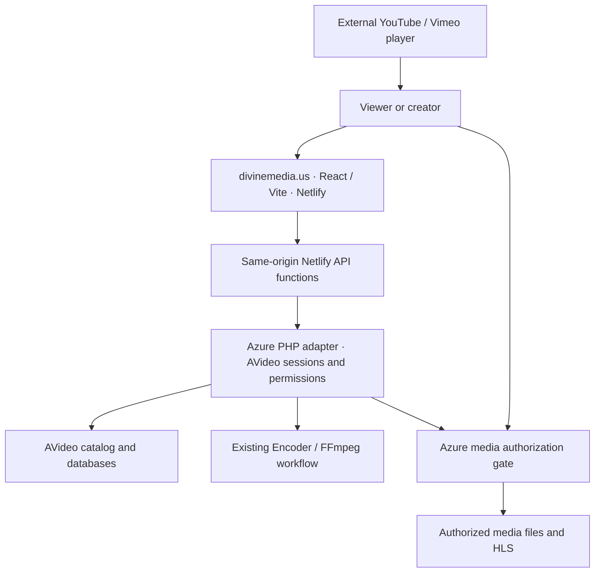

# Divine Media — Consolidated Development History

Updated: November 24, 2026 · Owner: Jarred Moore / Divine Creative Group

This is the continuity document for the Divine Media Codex workspace. It consolidates decisions, recorded releases, unresolved work, and the way we will develop features together. It is not a fresh certification of every live service. Repository files and release records were reviewed for this update; Azure and third-party accounts were not re-audited.

## Source of truth and scope

| Item | Authoritative location |
| --- | --- |
| Repository | https://github.com/jarredmoore/divinemedia |
| Production branch | `production/divine-media` |
| Repository homepage | `master` — historical backend source and overview documentation |
| Earlier integration baseline | `dev/divine-media-3.1` |
| Public viewer and creator experience | https://divinemedia.us/ |
| AVideo service/admin origin | https://media.divinemedia.us/ |
| Frontend hosting | Netlify; production site `mediaproduction` |
| Backend hosting | Azure; VM `vm-divinemedia-staging` is production-serving despite its name |
| Development | This Codex workspace, feature branches, pull requests, and previews |

Inspect the latest GitHub state before each implementation. Start release work from the current production baseline unless the task specifies another branch. A historical development branch or conversation is not proof of the current deployment.

The DCG corporate site is a separate project in `jarredmoore/dcgcontent`. Its Sanity CMS, Clerk login, Square booking, pricing, and corporate assets do not automatically apply to Divine Media. Do not create another site or replace working media authentication to mirror that stack.

Old `media.divinecreativegroup.com` references are historical. Use the canonical Divine Media domains for new UI and documentation; assess compatibility before removing an existing redirect or endpoint.

## Product goal

One lightweight public frontend for viewers and creators, backed by AVideo rather than a second public website. A creator should stay on `divinemedia.us` while uploading, embedding, editing metadata, selecting categories, adding thumbnails, and using available account tools. Native AVideo pages are operator/service interfaces, not the intended creator journey.

The deliverable includes secure login throughout the workflow and server-enforced public/private access for media. A hidden button, private page, or unlisted URL is not authorization.

Content ambitions include video on demand, audio listening, live entertainment, radio, and television-style programming, initially in the US and later internationally. Those ambitions do not establish distribution rights, complete broadcast readiness, or monetization approval.

## Current architecture

- `frontend/` contains the React 19/Vite 6 app, hls.js playback, and lucide-react icons.
- `frontend/netlify/functions/platform.mjs` bridges frontend workflows to the backend; `public-catalog.mjs` handles public catalog delivery.
- `backend/frontend-api/` adapts native AVideo capabilities. AVideo remains responsible for accounts, catalog state, permissions, reactions, comments, playlists, and installed plugin behavior.
- `backend/media-delivery/` and the Azure routing rules protect native file/HLS delivery. Media bytes do not flow through Netlify functions.
- Encoder and FFmpeg prepare media; preserve working queues, originals, thumbnail hooks, and storage.
- Embeds remain externally hosted. Provider restrictions and availability still apply.

See [unified frontend architecture](docs/UNIFIED-FRONTEND-ARCHITECTURE.md) for the earlier detailed diagram. Its November 9 static-file and legacy-route notes predate the later media gate; read them alongside [media gate operations](docs/MEDIA-GATE-OPERATIONS.md).

## Recorded development milestones

| Milestone | Recorded result / evidence |
| --- | --- |
| 3.1 baseline | Existing frontend carried forward into `dev/divine-media-3.1`; video/audio discovery and playback formed the redesign baseline. |
| 3.3 foundation | Canonical domains, branded entrance/login, creator workspace, and selectable themes; [PR #11](https://github.com/jarredmoore/divinemedia/pull/11). |
| Native capability review | Free/paid plugin inventory and frontend integration work; [plugin options](docs/AVIDEO-PLUGIN-OPTIONS.md). An installed or enabled plugin is not necessarily configured. |
| Unified frontend | Creator and viewer workflows moved toward the same frontend; [creator card](docs/CREATOR-TOOLS-CARD.md) and [media details](docs/CREATOR-MEDIA-DETAILS.md). |
| YouTube embed test | User confirmed the test worked after making a channel video public. Target test channel: https://www.youtube.com/@divinemediaUS. Private channel uploads do not appear in public discovery. |
| File authorization | Azure gate implementation and routing fixes merged through [PR #36](https://github.com/jarredmoore/divinemedia/pull/36) and [PR #37](https://github.com/jarredmoore/divinemedia/pull/37). |
| Code Black refinement | Approved mesh animation and darker section transitions shipped through [PR #38](https://github.com/jarredmoore/divinemedia/pull/38). Recorded production merge: `6858fed444d57fd5001de0d84b432373b158baaa`. |
| Documentation handoff | Homepage README updated through [PR #39](https://github.com/jarredmoore/divinemedia/pull/39), preserving requirements and version history. |

The recorded Netlify Code Black production deploy is `6affba141dbabae7b00fb836`. At release, the homepage and assets returned HTTP 200 and the live shader matched the tested build. This is a release reference, not a claim that no subsequent deployment exists.

## Brand and interaction standards

### Code Black

- Deep black backgrounds, translucent charcoal glass, thin neutral borders, white headings, and readable gray supporting text.
- Official Divine Media D mark; cyan → blue → violet → pink is the primary color direction.
- Color belongs mainly in consistent icons and small local highlights. Avoid broad glows, fog, and washed-out section transitions.
- No gold, champagne, bronze, or warm beige interface styling. Artwork and media are not recolored to enforce the interface palette.
- Glass surfaces need solid charcoal fallbacks; retain visible keyboard focus and readable text over imagery.
- Invisible scrollbars/tracks should retain scrolling, keyboard access, and clear navigation.

### Cozy

The former Default theme is now **Cozy**. Its yellow accents are intentional; do not remove them as part of Code Black cleanup. Black play icons on Cozy action buttons are an approved direction.

### Motion

The Code Black hero uses one dependency-free WebGL fragment shader with domain-warped 3D simplex noise. A faint truss poster remains; a second background video does not run behind it.

- Palette: base `#070812`, indigo `#1B2873`, teal `#0FA98C`, violet `#6543CF`, magenta `#D6408F`, very restrained orange `#FF6A2A`, and faint cyan `#63E2FF`.
- Slow roughly 60-second drift, fine shader grain, deeper black areas, and a clearer fade into following sections.
- Added shader/wrapper JavaScript stays below 8 KB; no new dependency.
- Rendering capped at 24 fps, DPR 2, and approximately 1.2 megapixels.
- Pause for hidden tabs, offscreen content, and active media; provide a user pause control.
- Reduced motion/data saving use a static frame; CSS gradients cover unavailable or lost WebGL.

Shared theme sources include `frontend/src/black-glass.css`, `cold-black.css`, `mesh-gradient.css`, and the existing icon components. Inspect current tokens before adding another override or competing design system.

## Creator workflow to streamline

One studio card, with a flat path and progressive options rather than a maze of backend pages:

1. Choose a supported creation method: upload/encode, embed a link, bulk embed, or a configured live/article tool.
2. Select a file or provider link; show supported formats, limits, and available processing options accurately.
3. Add title, description, visibility, category, tags, and thumbnail/cover image where supported.
4. Show upload/encoding progress and clear draft/publication status.
5. Return to the creator's content and edit it without a native-backend detour.

These are the experience requirements to verify, not a claim every route and option is complete. Account/social login options must reflect actual provider configuration. Do not present inactive providers as working authentication.

The user previously configured a parent/child category structure. Inspect existing categories before changing it. Categories, tags, file types, schema.org types, and copyright registration classes are different concepts. A semantic entertainment taxonomy remains a side project; [taxonomy proposal](docs/MEDIA-TAXONOMY-PROPOSAL.md) is not approval to recategorize the catalog.

## Integrations and plugin decisions

- Inspect installed AVideo plugins and upstream capabilities before writing replacement functionality.
- Prioritize basic native Live, playlists, then justified extras. Do not build a suite of replacements for paid plugins.
- Keep new UI in the frontend while native authorization and persistence stay in the backend.
- Azure Media Services is retired; do not plan new delivery around that product. Evaluate any replacement separately against a concrete need and cost.
- YouTube **embedding** and **downloading/importing** are separate workflows. A YouTube Data API key does not resolve downloader runtime or anti-bot failures.
- Earlier downloader errors involved a missing supported JavaScript runtime and YouTube sign-in/anti-bot restrictions. Do not reopen downloading when the task is embedding.
- Thumbnail failures need their own diagnosis: distinguish absent metadata, missing generated files, denied URLs, and stale frontend data. Use a safe fallback without masking processing errors.
- AdSense ownership was reported, but the domain approval status remained unchecked. Do not call ads or monetization active without verification.
- Rights, subscriptions, payment configuration, paid plugin licenses, and international broadcast permissions require independent confirmation.

## Security and operational boundaries

The Azure media gate checks native permissions before protected file/HLS delivery, including segments and keys. Public media supports ordinary playback and range requests. Login uses a short-lived handoff to establish the media-origin session; secrets and native session IDs must not enter media URLs.

Recorded remaining limitations:

- Private casting requires an authenticated receiver handoff; a copied URL is insufficient.
- Password-protected live streams fail closed until the frontend unlock flow is verified.
- External provider privacy remains under that provider's control.
- The gate is not DRM and cannot recall bytes already delivered.
- Netlify previews can encounter third-party-cookie restrictions; test canonical same-site domains without weakening production cookies.

Keep credentials out of source, browser bundles, documentation, screenshots, and logs. Store only variable names in examples. Do not copy keys or authorization callback codes from old conversations into documentation.

Before Azure mutations, inspect the affected services, verify a recoverable backup and rollback path, and preserve existing media and processing. A prior successful backup is not proof that today's backup is current. Do not restart containers or launch global encoding jobs as routine verification.

The November 24 studio refinement was approved and released through PR #41; Cozy’s collapsed sidebar followed in PR #42. November 25 media management, Square card and YouTube metadata work shipped through PR #43, with rollout evidence in PR #44. See [release evidence](docs/MEDIA-MANAGEMENT-RELEASE.json). The unified provider-link/import workflow is current feature-branch work and is not activated in production; see [unified link import](docs/UNIFIED-LINK-IMPORT.md).

## Known resolved issues versus open work

- The reported login failure was confirmed by the user to be an incorrect username. Do not replace authentication without a reproducible new issue.
- The November 19 visual release passed 42 frontend tests, Vite build, and Chromium desktop/mobile checks for sizing, pause/resume, hidden-tab pause, reduced motion, context loss, fallback, and Cozy isolation.
- Those checks do not replace real-device playback, creator workflow, or security validation.
- Social/PWA icon work, backend theming, and creator options have development history, but their full coverage needs route-specific testing before claiming completion.
- Private receiver casting, live-password unlock, provider configuration, and monetization readiness remain follow-ups.

## Working together from here

Work on one focused feature at a time. For each feature, record:

| Field | What to capture |
| --- | --- |
| Goal | The user-visible task and what currently gets in the way |
| Existing capability | Native plugin/API support and configured permissions |
| Small change | The smallest reversible frontend/backend change needed |
| Acceptance | The exact creator/viewer path that must work |
| Evidence | Relevant tests, preview URL, and real-device feedback |
| Release | PR, explicit production approval, deploy reference, rollback |

Suggested next order, pending the user's choice:

1. Walk through studio upload and embed flows, metadata, categories, visibility, and thumbnail selection on desktop/mobile.
2. Remove remaining creator-facing native-route detours and confusing or unconfigured options.
3. Validate playback, seek, volume, next/previous, fullscreen, public casting, and mobile/PWA behavior.
4. Complete the separately scoped private casting and live-password workflows.
5. Revisit taxonomy, plugin extras, analytics, ads, and licensed broadcast expansion after the core paths are reliable.

No additional feature is authorized merely by appearing in this list. Do not batch unrelated improvements into the current task.

## Development and release routine

1. Read this document and relevant focused docs; inspect GitHub and the working tree.
2. Create a small feature branch. Preserve another task's uncommitted changes.
3. Reuse existing APIs, tokens, components, and installed plugin capabilities.
4. Run checks appropriate to the change. For frontend code: `npm --prefix frontend test` and `npm --prefix frontend run build`, plus targeted browser checks when behavior changes.
5. Open a pull request and provide a working preview. Keep source approval and deployment verification distinct.
6. **Never merge into or deploy production without explicit approval.** Prior approval for a particular release does not approve later unrelated features.
7. After an approved deployment, verify the actual live assets/behavior and record a rollback reference.
8. Update this history when decisions or release status change; keep detailed implementation evidence in focused docs.

## Documentation map

- [README](README.md): overview, requirements, setup, and version history.
- This document: consolidated history, decisions, and next-session context.
- [Development workflow](DIVINE-MEDIA-DEVELOPMENT-WORKFLOW.md): existing operational checklist.
- [Project charter](PROJECT.md), [experience direction](EXPERIENCE_DIRECTION.md), [changelog](CHANGELOG.md): earlier baselines and recorded milestones.
- [Plugin options](docs/AVIDEO-PLUGIN-OPTIONS.md), [creator card](docs/CREATOR-TOOLS-CARD.md), [creator media details](docs/CREATOR-MEDIA-DETAILS.md): focused feature context.
- [Media gate operations](docs/MEDIA-GATE-OPERATIONS.md): protected delivery and security limitations.
- [Broadcast plan](docs/BROADCAST-MONETIZATION-PLAN.md): proposed expansion, not proof of readiness.

The October [master guide](DIVINE-MEDIA-MASTER.md) remains historical. Its lime palette, `divine-media-2` baseline, and proposed parallel app layout are superseded as current instructions. Do not recreate them over the working frontend.
