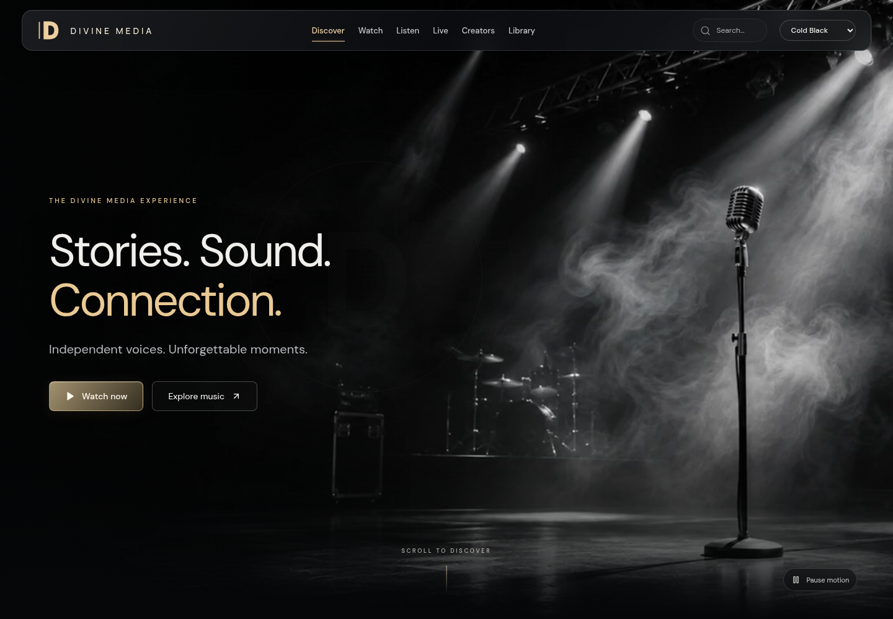
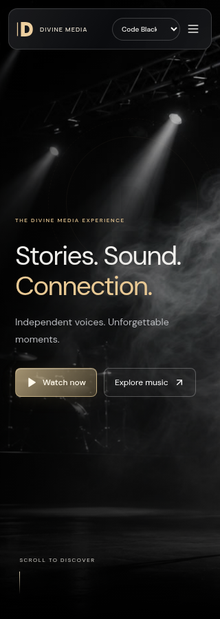

# Code Black viewing theme

Code Black is an optional Watch frontend theme. First visits retain the existing **Default** theme. Use the header's **Viewing theme** selector, or `?theme=code-black`, to choose the cinematic version. The choice is saved in browser-local storage; switching themes keeps the current catalog, saved titles, audio track and playback controls.

The theme adds a floating smoked-glass navigation bar, a champagne D monogram and spaced wordmark, a full-screen stage background, a pinned split-scene scroll transition, full-bleed featured programming and quiet media shelves. All six existing navigation destinations remain accessible, including through the mobile menu. No Webflow template code, imagery or video is included.

[Open the working Code Black preview](https://6aefc75309917db3b70bb1a8--mediaproduction.netlify.app/?theme=code-black) · [Pull request #10](https://github.com/jarredmoore/divinemedia/pull/10) · [Deployed browser verification](COLD-BLACK-BROWSER-VERIFICATION.json)

The Netlify draft is built from frontend commit `a20f3c33679f022ed22c8c38f17df2e9fc040bbf`. Later documentation/evidence commits do not change its frontend source. The existing public deploy and production-branch SHA were verified unchanged.

The base canvas is pure black (`#000000`). Legacy `?theme=cold-black` links and saved preferences still select Code Black. Internal asset filenames remain compatible.

## Background and motion

`frontend/public/themes/cold-black/stage-poster.jpg` is compressed original AI-generated stage artwork created for this theme. `stage-loop.mp4` animates a gentle, seamless camera drift over that artwork; it is not recorded concert footage. The silent H.264 loop is 14 seconds, 1280 × 720 and 458,383 bytes. The poster is approximately 89 KB. Both assets ship with the frontend; no third-party video service is needed.

Only Code Black's Discover screen mounts the video. It is muted and inline, with a visible pause/play control. It pauses when off-screen, when the document is hidden, when a media dialog opens, or while dock audio is playing. Reduced-motion and supported data-saver preferences omit the video and use the still image without the pinned transition. Playback failure leaves the poster available. Browsers can also decline autoplay; the play control allows a manual retry.

The reference informed the cinematic composition and scroll treatment. Scrolling remains native; there is no scroll hijacking or new animation dependency. Actual AVideo uploads, encoding, thumbnails, backend routes, databases and containers are unchanged.

## Validation

- `cd frontend && npm test && npm run build`
- The read-only Chromium integration check is `frontend/tests/browser/cold-black.cjs`. Set `PLAYWRIGHT_MODULE` to an installed Playwright module if it is not in the normal Node module path, `CHROMIUM_PATH` to the browser binary, and `COLD_BLACK_TEST_URL` to a local preview or Netlify draft origin. `BROWSER_ARTIFACTS` selects its output directory (default `/tmp/divine-media-cold-black`). Run it with Node from any directory. HTTPS resources are fetched using curl with normal certificate verification; no credential or sign-in is used. For a local static preview, the same-origin catalog response comes from the current public Watch catalog. Foreground MP4 responses use bounded byte ranges.
- The browser check covers Default's initial state, no background-video requests in Default, URL/preference persistence, background playback/pause, split-scroll behavior, reduced motion, data saver, real MP3 playback, Murphy Lee artwork, volume/mute/seek/previous/next, track continuity across theme switches, mobile navigation/search, and widths of 320, 390, 768, 1024 and 1440 pixels.

This work is delivered on a feature branch with a Netlify draft and a pull request against `dev/divine-media-3.1`. The public deployment and `production/divine-media` are not promoted by this change. Selecting Default is the immediate visual fallback; reverting the theme commit removes the option. The preview uses the existing public catalog but does not submit uploads or encoding jobs.

