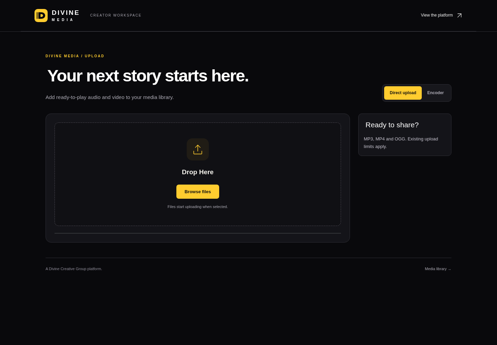
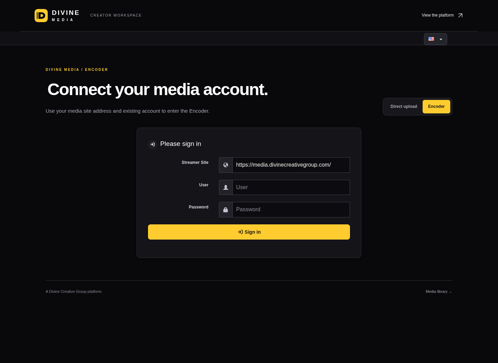
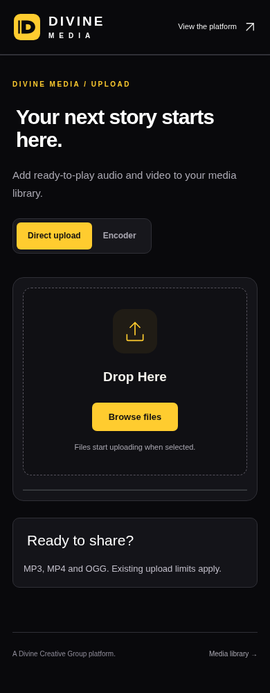
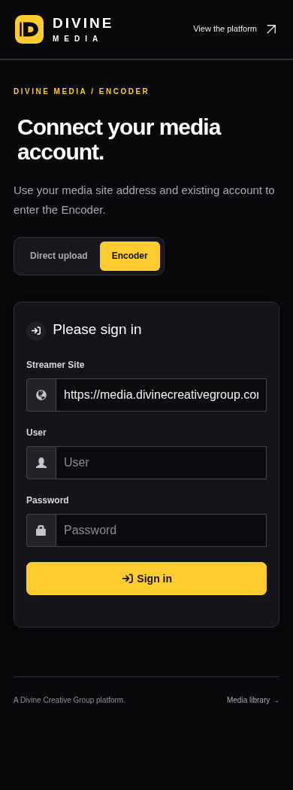
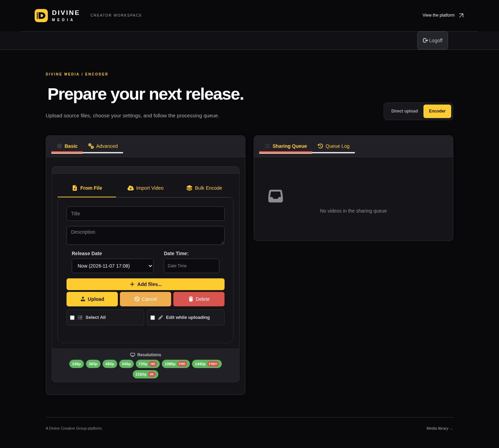
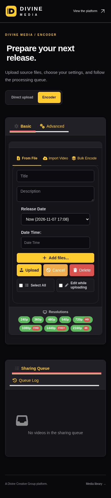

# Divine Media creator workspace

A shared black-and-gold presentation for the native direct uploader and Encoder. The two services retain their separate authentication and upload behavior. No upload, authentication, queue or thumbnail handler is replaced.

## Routes and behavior

- `/upload`: existing access rules, MP3/MP4/OGG guidance, server-generated limits, browse/drop controls, automatic upload, progress and cancellation.
- `/Encoder/`: existing site/account connection, source upload options, settings and processing queue.
- Tabs link between the existing routes. Embedded and `noNavbar` modes retain native presentation.
- Existing form nodes and listeners are moved together into a branded container, rather than rebuilt. Native form actions and hidden inputs remain untouched.
- Native account and language menus remain available. The landing page, login, videos and thumbnails are outside this installer’s scope.

## Reversible installation

`ops/divinemedia/apply-creator.py` patches only `view/mini-upload-form/index.php` and `.compose/encoder/view/index.php` with a shared include before `</body>`. It installs four assets under `divine-creator/`.

Run first without `--apply` to inspect the SHA plan. For installation, provide the source hashes verified in isolation with `--expected`. The installer refuses an existing theme directory, unexpected source or duplicate hooks. Use a private backup location outside the public app tree.

```sh
python3 apply-creator.py --root /srv/divinemedia/app \
  --assets /private/release/assets --backup-root /srv/divinemedia/backups \
  --expected /private/release/expected-source.json --apply
```

Keep the reported `rollback_snapshot`. Restore using:

```sh
python3 apply-creator.py --root /srv/divinemedia/app \
  --rollback /srv/divinemedia/backups/creator-TIMESTAMP
```

Rollback checks installed file hashes and refuses to overwrite later changes. Assets are readable under a restrictive deployment umask; snapshots remain private.

## Design previews

The Encoder preview uses the public connection form with native styles. Direct Upload previews use the sanitized native form rendered by an authenticated creator in the isolated restore, with a representative guidance sidebar. These previews are design evidence, not proof of successful media processing.

| Direct upload | Encoder connection |
| --- | --- |
|  |  |
|  |  |

## Validation

Local browser checks cover both pages at 1440px and 390px, horizontal overflow, original form identity, retained submit listeners and native input IDs. All network traffic is intercepted; no production upload is submitted. Installer tests cover exact rollback, restrictive umask, source leases and refusal to destroy later changes. The production direct-upload script also passes a browser check with mocked transport: browse triggers the existing input, file addition submits once, progress reaches 50%, cancellation aborts, and failure retains its error state. Actual upload/encoding jobs are excluded from visual validation.

The isolated restored runtime passes PHP lint, the guest Encoder connection form, an authenticated native media uploader, and Encoder upload/settings/tabs rendered with a temporary signed-in fixture. The fixture and test account exist only in the clone, which has an internal network and no processing startup. Handler hashes remain unchanged, rollback/reapply passes, and all scratch containers/network/files are removed. This verifies rendering and installation; it does not verify a real Encoder sign-in or processing job. See [stage evidence](CREATOR-STAGE-VERIFICATION.json).

## Signed-in Encoder preview

The isolated signed-in view uses sanitized server-rendered controls, with account values and executable content removed. It verifies the shared layout at desktop and mobile sizes; production authentication and job submission are not exercised.





## Deployment — 2026-11-07

Live source commit: `61f96e4c30ae30cb8305d01b652b5d65313f2309`, release `0b8df6f2022d`. Installed from the feature branch without merging either the integration or production branch.

Public checks pass for the entrance, login, native library, audio/video filters, embed and Encoder routes. Guests at `/upload` retain the native 302 login redirect. The Encoder connection form and all three public theme assets return 200. Seven native/routing files and all five entrance assets retain their hashes; the queue is unchanged, the catalog remains 16 records, all 52 original media hashes match, and MP3/MP4 range requests return 206. Existing containers remain healthy without restarts.

Rollback snapshot: `/srv/divinemedia/backups/creator-20261107T171602Z-325e71`. See [live evidence](CREATOR-LIVE-VERIFICATION.json). No production upload, real Encoder sign-in, or processing job was performed.

Final public connection and sanitized signed-in Encoder browser checks pass at 320, 390, 768 and 1440 pixels, without page overflow. The signed-in upload and queue panels share the available desktop width and stack on smaller screens; native action labels remain readable. See [browser evidence](CREATOR-BROWSER-VERIFICATION.json).
