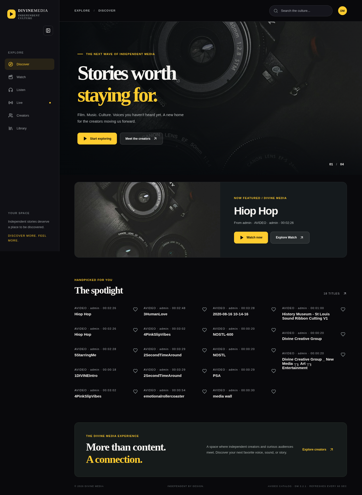
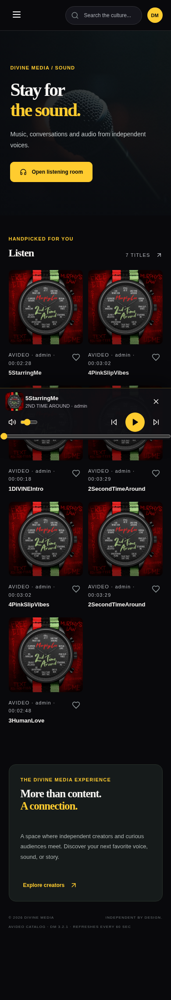
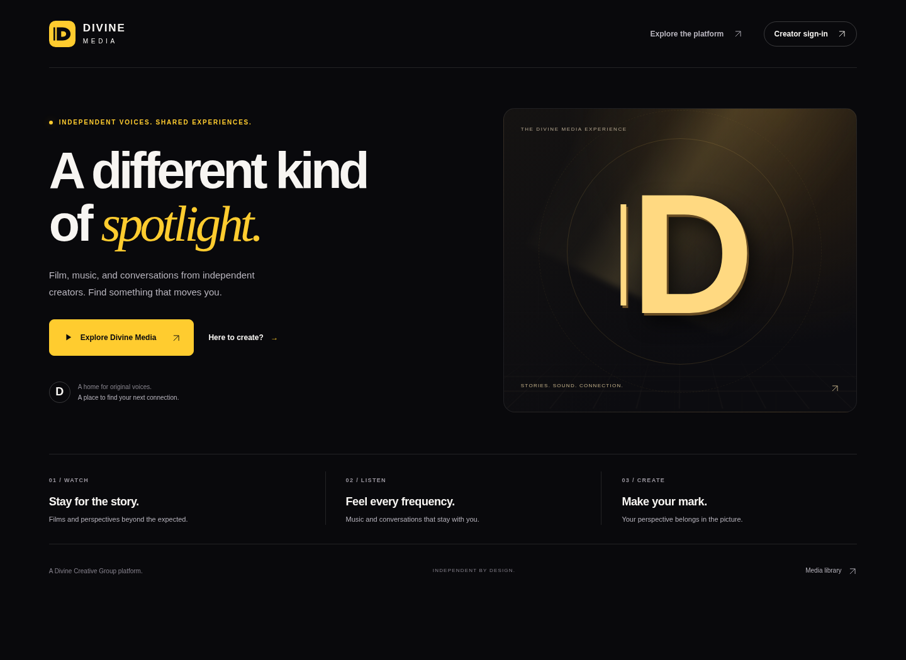
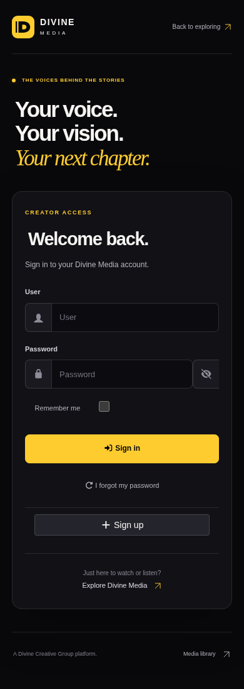
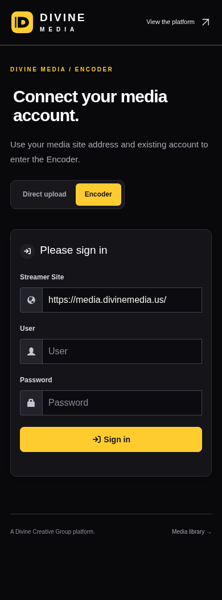

# Divine Media domain migration

## Approved destination structure

| Destination | Role |
| --- | --- |
| `https://divinemedia.us/` | Canonical Watch frontend on Netlify |
| `https://www.divinemedia.us/` | Netlify-managed redirect to the canonical frontend |
| `https://media.divinemedia.us/` | AVideo entrance and media backend on Azure |
| `https://media.divinemedia.us/user` | Existing native account login |
| `https://media.divinemedia.us/upload` | Existing native direct upload |
| `https://media.divinemedia.us/Encoder/` | Existing Encoder connection and workspace |

The previous Watch hostname redirects to the new frontend with its path/query preserved. The previous media hostname remains a supported HTTPS alias for media files, API reads, embeds, callbacks, and older clients. Legacy login, uploader, and Encoder entry GET/HEAD requests redirect to the new media hostname. Credential-bearing entry queries are discarded; the safe compact `noNavbar` option is retained. Do not indiscriminately redirect upload POSTs or credential-bearing Encoder URLs between hosts. Sessions remain host-specific; users sign in on the new media hostname.

## Source and scope

Branch `feat/divine-media-3.3-domains` integrates the already-developed audio, entrance, and creator-workspace feature branches before applying domain changes. It does not merge or modify `production/divine-media`.

`frontend/shared/domains.mjs` defines the public origins. The catalog adapter and frontend normalize only the explicitly trusted old/new media hosts, preserve media paths, and reject foreign hosts and URL credentials. Backend presentation links use the new Watch domain. Only the main `configurations.encoderURL` and the Encoder `configurations_encoder.allowedStreamersURL` URL settings are changed in the databases, under exact-value leases. Existing allow-list entries are retained. The forced Encoder streamer address is updated in its configuration file. No video rows, media bytes, thumbnail processing, or encoding jobs are migration targets.

## Hosting inventory before migration

- Existing main-domain site: `mediaproduction`, ID `74211341-4673-4a96-8a18-927fffe55e91`; primary hostname `www.divinemedia.us`; old mockup deploy `5df0740e8350b4ec783ddfd5`.
- Existing Watch site: `divinemedia-staging`, ID `b4e427bb-d612-415c-8458-e24423a9f1ec`; primary hostname `watch.divinecreativegroup.com`; deploy `6aeea28ede7b2dcf0123b163`.
- Main domain DNS is managed in Netlify. Existing apex/www and email records remain intact. New `media` A record points to the existing Azure backend IP with a 300-second TTL.
- The old Watch site is associated with the production Git branch. Any future automated build changes must account for its retirement as a public frontend.

Private provider exports and backup/configuration snapshots belong outside Git. Public deploy IDs are rollback references, not credentials.

## Cutover sequence

1. Record current published deploys, DNS, certificates, source hashes, and backend configuration. Verify recovery coverage and create a private current-state snapshot before backend changes.
2. Add only the new media DNS record. Issue a certificate covering both media hostnames, validate Apache configuration, and gracefully reload HTTPS without restarting containers.
3. Verify new/old host access to the same backend, API, MP3/MP4 range responses, and native login/Encoder routes.
4. Update the two backend public base URLs and branded presentation links with hash-checked backups and rollback. Keep legacy media access working; preserve all existing media and queue state.
5. Build the committed frontend, deploy a Netlify draft with its catalog function, and validate catalog, artwork, playback, login links, and mobile rendering.
6. Publish the verified draft to the existing main-domain site. Set `divinemedia.us` as primary, retaining `www` as an alias/redirect. Avoid an apex/www redirect loop during the transition.
7. Publish the tracked `frontend/legacy-watch/_redirects` artifact on the old Watch site after the destination passes. Preserve its previous deploy for rollback and prevent an automatic legacy build from replacing the redirect.
8. Record final deployment IDs, source commit, certificates, DNS, redirect checks, catalog/media/handler hashes, and recovery instructions. Update repository-facing links after verification.

## Rollback

Restore the original Netlify deploys on their respective sites and the prior main-domain primary/alias settings. Restore any changed legacy build setting. The new DNS record is additive and can be removed by its recorded ID after clients no longer use it.

Restore backend configuration and presentation files only if their installed hashes still match the migration plan; retain the original certificate and vhost snapshot. Validate Apache before a graceful reload. Do not restore whole databases or media directories to undo a hostname change.

## Build and tests

Use `npm ci`, `npm test`, and `npm run build` in `frontend/`. Both `VITE_AVIDEO_ORIGIN` and server-side `AVIDEO_ORIGIN` can explicitly select the old approved media origin for a controlled fallback. Production defaults target the new domain; do not publish until its HTTPS and backend checks pass.

## Completed cutover — November 7, 2026

- Watch: `https://divinemedia.us/`, serving verified Netlify deploy `6aefae007b01dc9671e0b50f`. The deployed frontend and backend migration source is commit `79a18229f8840f08c969597cf74536c2c06fde03`; later commits add renewal operations and evidence.
- `www.divinemedia.us` redirects to the apex. `watch.divinecreativegroup.com` redirects with paths/queries preserved, using redirect deploy `6aefb0c17119fcbf43d02aab`.
- Media: `https://media.divinemedia.us/`, including native `/user`, `/upload`, and `/Encoder/`. The old media hostname retains compatible API/static/embed/callback access; browser auth entry points redirect to the new origin.
- The new certificate covers both media hostnames and expires February 5, 2027. The existing running Certbot cron renews all certificates. A persistent, tested lineage-specific deploy hook gracefully reloads Apache after this certificate renews.
- Existing DNS and mail records are unchanged. Only the new `media` A record was added (record `6aefa3b4543fb4ce9de5a90c`).
- Current live preservation checks cover **18 catalog records and 54 MP3/MP4 files**, ten unchanged native handler/template/routing files, and an unchanged Encoder queue. All containers retain their existing uptime; Apache was gracefully reloaded.
- Actual MP3 playback, Murphy Lee artwork, volume, mute/unmute, seek, previous/next and responsive layouts pass in Chromium at 320, 390, 768 and 1440 pixels. Native entrance/login/Encoder rendering and canonical links pass. Real account sign-in, a production upload, and an encoding job were not performed.

### Git and build delivery

The new main site was previously a manual Netlify site. This cutover pins it to the verified deployment built from committed feature-branch source. Automatic Git-based production delivery should be connected to `production/divine-media` only alongside an explicitly approved production-branch promotion. The production branch was not changed for this cutover.

Automatic builds on the retired Watch site are paused so a later production-branch push cannot overwrite its redirect. Repository, branch, base, publish directory and build command are preserved. Restore its previous `stop_builds: false` setting if rolling back that site.

Browser sessions and browser-local saved-library storage are origin-specific. Existing account records remain in the same backend; users sign in on the new hostname. This migration does not transfer browser storage between origins.

### Recovery references

- Private domain snapshot: `/srv/divinemedia/backups/domains-20261107T222154Z-70a793`. Configuration/TLS archives and selected URL settings have verified private off-VM copies; active TLS and the renewal hook are also backed up.
- Application/vhost rollback: `application-f3fbe904` beneath that snapshot, using `apply-domain-config.py --rollback`.
- Selected URL-setting rollback: `settings-f3fbe904`, using `domain_settings.rollback` with the original database container names.
- Original main-site deploy: `5df0740e8350b4ec783ddfd5`, with `www.divinemedia.us` as primary and the prior alias settings.
- Original Watch deploy: `6aeea28ede7b2dcf0123b163`; restore its automatic-build setting if reverting the redirect.
- The new hook can be removed on rollback only if its hash still matches the recorded installed hash. Do not remove the certificate files while any vhost references them.

The full restore rehearsal uses the earlier verified 16-record/52-file recovery baseline plus current configuration/TLS/URL-setting supplements. The 18-record/54-file result is the current live preservation check. Domain supplements are not a new full media/database backup; no whole-database restore is part of hostname rollback.

### Evidence and previews

[Backend preservation](DOMAIN-BACKEND-VERIFICATION.json) · [isolated verification](DOMAIN-STAGE-VERIFICATION.json) · [certificate and backup proof](DOMAIN-CERTIFICATE-VERIFICATION.json) · [DNS preservation](DOMAIN-DNS-VERIFICATION.json) · [browser and Netlify checks](DOMAIN-FRONTEND-VERIFICATION.json)

