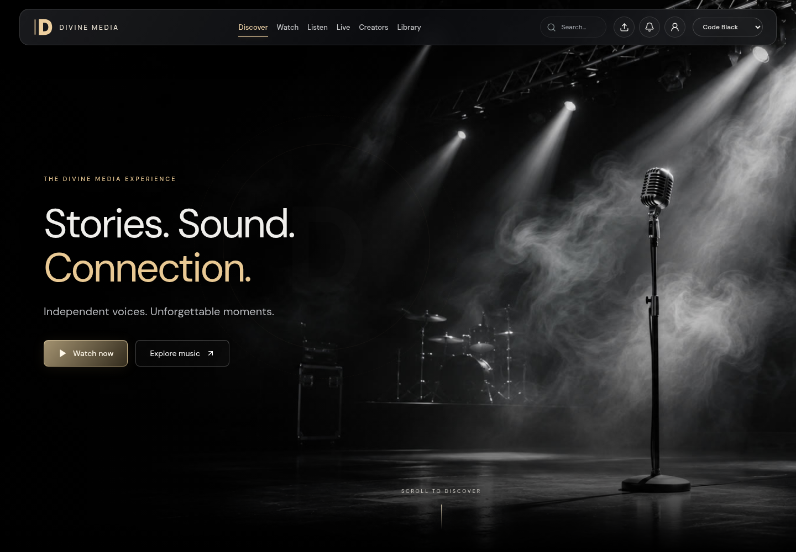
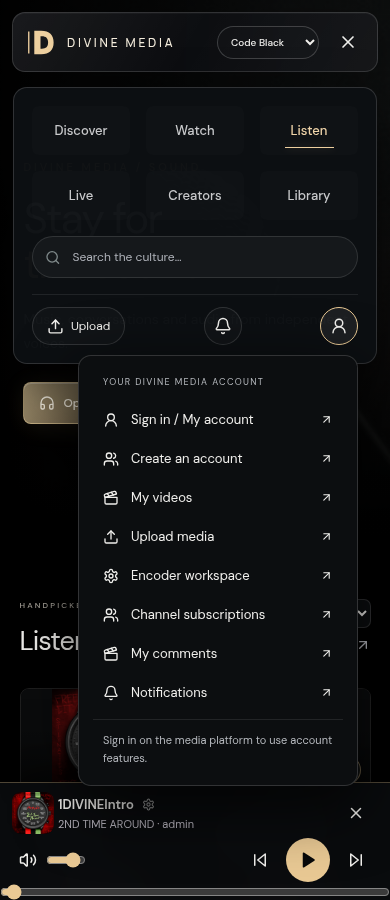

# Native AVideo features and frontend activation

Current update: [native Live and account playlists](DIVINE-MEDIA-NATIVE-LIVE.md) are now enabled; explicitly active plugins total eleven. The nine-plugin counts and player-utility rollback below describe the earlier audit.

[Open the working feature preview](https://6af0e7c0c7c99c2a27543abe--mediaproduction.netlify.app/?theme=code-black) · [Feature PR #12](https://github.com/jarredmoore/divinemedia/pull/12) · [Deployed browser evidence](NATIVE-FRONTEND-DEPLOYED-VERIFICATION.json)

Frontend source for the draft is commit `f48a6cae`; later commits update documentation and evidence.

## Production release

The owner explicitly approved production promotion in this session. PR #10 integrated Code Black into development; [PR #11](https://github.com/jarredmoore/divinemedia/pull/11) merged development into `production/divine-media` at `5067877dbd56bcd769812f42b46b15576848753f`. The previously tested Code Black draft `6aefc9b7bac75e020823b88a` is now the published Netlify deploy at https://divinemedia.us. The prior deploy `6aefae007b01dc9671e0b50f` remains the rollback reference. Both Default and Code Black remain selectable. Actual production playback and responsive checks passed; see [release](PRODUCTION-3.3-RELEASE.json) and [browser verification](PRODUCTION-3.3-BROWSER-VERIFICATION.json).

Netlify production currently promotes verified, committed drafts. The main site has no automatic Git build connection. This release did not connect automatic delivery or restart Azure. The older Watch site's automatic builds remain paused to preserve its redirect.

## Verified installation and upstream audit

The live installation reports AVideo **30.2**, with **80 plugin directories** and **nine explicitly active plugin records**: API, CustomizeAdvanced, CustomizeUser, Gallery, Layout, Permissions, PlayerSkins, Scheduler and UserNotifications. No paid package directories were present; no marketplace account ownership or licenses were inferred from file presence.

The complete [free/paid plugin matrix](AVIDEO-PLUGIN-OPTIONS.md) and [structured options](AVIDEO-PLUGIN-OPTIONS.json) cover 122 documented entries, including 43 paid entries not installed in this runtime. The matrix reflects the pre-change inventory; candidate utility plugins were rolled back, so its nine-active baseline remains accurate. Current price listings are informational; nothing was bought, and no payment gateway or outward messaging integration was activated.

Sources checked directly:

- [Main AVideo repository](https://github.com/WWBN/AVideo) and current plugin directory.
- [Plugin documentation index](https://github.com/WWBN/AVideo/wiki/Plugin-Documentation-Index), [admin manual](https://github.com/WWBN/AVideo/wiki/Admin-Manual), and [official marketplace](https://streamphp.com/marketplace/).
- [Custom frontend reference](https://github.com/WWBN/AVideo/wiki/Build-Your-Own-Frontend) and [native player embed contract](https://github.com/WWBN/AVideo/wiki/Video-Embed-URL-for-AVideo).

## Working frontend additions

The feature branch adds controls to both Default and Code Black. They reuse the installed AVideo platform:

| Control | Behavior / owner |
| --- | --- |
| Account icon | Native sign-in/account, registration, video manager, uploads, Encoder, channel subscriptions and comments links. Channel subscriptions are creator follows, not paid memberships. AVideo performs authentication and permissions. |
| Upload icon | Opens the verified native upload route; no second uploader implementation. |
| Notifications bell | Presents the installed UserNotifications interface in a dialog, with an account sign-in link. No fake unread count or public account-token API. |
| Watch player | Uses the canonical AVideo `videoEmbed` route with configured controls, rather than bypassing plugins through a direct MP4 element. External curated videos retain their existing fallback. |
| Share / copy / embed | Uses the canonical content link or documented iframe address, with clipboard fallback. Sharing and embedding still depend on native access policies; copying a URL does not grant access. |
| Comments and reactions | Opens the full native content page; mutations, moderation, favorites and channel subscriptions stay with AVideo. |
| Audio track options | The current track title opens sharing/embed/channel options without starting a duplicate audio stream. |
| Creator channel | Opens the native channel; the creator directory also links the native channel browser. |
| Sorting | Client display order: current catalog order, title, or creator. |
| Saved titles | Existing browser-only bookmarks remain explicitly labeled “Saved on this device”; they are not represented as AVideo account favorites. |

No API secret, account password or user token is embedded in browser code. Real account sign-in, registration, comment submission and payment flows were not exercised; anonymous links and UI wiring were checked. Those workflows remain native and require an authorized test account to verify their authenticated behavior.

## Player utility activation result

Hotkeys, NextButton, SeekButton and TheaterButton were selected as free player-only candidates. Source inspection rejects lifecycle hooks or background processing. The isolated restored stack passed with these plugins: both databases validated, 52 original media hashes verified, and the native player rendered the expected utility code. The native startup/Encoder entrypoint was bypassed. See [isolated report](NATIVE-PLAYER-STAGE-VERIFICATION.json).

Live activation did **not** pass its native-render check: the expected utility footer code was absent. Configuration changes were rolled back rather than left active. Targeted native plugin-cache invalidation and the native plugin-save path did not resolve the mismatch. Its root cause is not established. The nine active plugins remain the baseline. [Live activation result](NATIVE-PLAYER-LIVE-ACTIVATION.json) and [verified rollback](NATIVE-PLAYER-ROLLBACK-VERIFICATION.json) record this outcome. Before snapshots have verified private off-VM copies; the final rollback check compares all current media hashes, catalog fields and container uptime. No migrations, reencoding or thumbnail processing were run.

`ops/divinemedia/activate-player-utilities.py` is a guarded candidate operation, not a successful deployment or a suggested repeat-until-success procedure. Resolve the live render mismatch and rerun a representative isolated test before trying it again. Rollback must lease the exact recorded new plugin rows and delete only those rows, then invalidate only the plugin cache keys. Never restore an entire database to undo plugin flags.

## Native-first priorities

1. **PlayLists**: included for playlists, Watch Later and account favorites. Audit/install its schema and Scheduler/rebroadcast interactions before enabling; connect the frontend to this native account library instead of implementing a second playlist database.
2. **Live / WebRTC / YPTSocket**: included code, currently inactive. Validate ingest/HLS URLs, socket connectivity, permissions, recording policy and costs in staging. Do not start broadcasts or turn on automatic recording/Encoder jobs merely to populate a menu.
3. **PlayerSkins / UI utilities**: use native parameters for controls, sharing and playback appearance; resolve the failed utility rollout first. TheaterButton intentionally hides itself in embeds/mobile, and NextButton requires a valid next item.
4. **Account APIs**: use the upstream React reference and documented endpoints only after deciding the session/CSRF/CORS model. Native links are active now; a unified React signed-in session is not implemented by these links.
5. **Paid viewing features**: Subscription, PayPerView and FansSubscriptions are currently listed at $59.99 each; quality switching and hover thumbnails at $29.99 each; Customize and Notifications at $19.99 each; Chat2 at $59.99. Review license/version compatibility, dependencies, payment accounts and business rules before purchasing or exposing checkout. Native backend styling and API/embed support must be confirmed per plugin.
6. **Operational add-ons**: storage/CDN, backup, SMTP/push and social login require separate configuration and possibly service charges. This audit does not establish recurring full-media backups; previous full recovery baseline and current configuration supplements remain distinct.

## Validation and delivery

Ten frontend unit tests cover the catalog, URL trust and native player URL behavior. Vite builds pass. Read-only browser checks cover account/creator links, native notification wiring, native embed addresses, share/copy/embed, sorting, initialized native play/fullscreen controls, audio track options without a duplicate stream, and responsive widths 320, 390, 768, 1024, 1200 and 1440. All non-GET requests are blocked during browser verification. The existing production player suite also passed after the approved release.

New feature work is isolated from the already-approved production release. It is delivered as a development PR and a Netlify draft so the expanded controls can be reviewed before further mobile/text-wrap refinements or production promotion.

