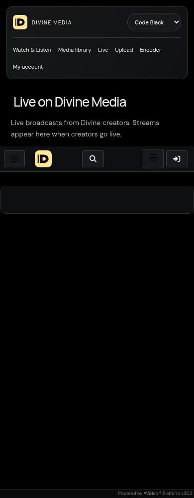

# Native Live and account playlists

Divine Media uses the installed free **AVideo Live 15.3** and **PlayLists 3.0** plugins. AVideo owns accounts, stream keys, publishing permissions, playlists and player behavior. Azure hosts the existing stream server and application. No second account system, chat service, replacement paid-plugin suite or additional public domain is introduced.

## Native routes

- `https://media.divinemedia.us/live` is the native live directory. Watch's existing Live navigation opens it with the selected theme.
- `https://media.divinemedia.us/plugin/Live/` is the native creator studio, protected by existing sign-in and streaming permissions.
- Native Watch Later and Favorites remain account features; the React Library remains explicitly local-device saves.
- HLS uses `https://media.divinemedia.us/hls/live/…` through a narrow Apache proxy to the existing NGINX server. Native encrypted-key authorization remains at NGINX. Stats and control endpoints are not proxied publicly.
- OBS ingest uses the native RTMP server, `rtmp://media.divinemedia.us/live`. Obtain the stream key privately inside Live Studio; do not place it in issues, screenshots or chat. RTMP ingest is not TLS-encrypted; HTTPS protects viewer delivery. RTMPS is a separate transport hardening task.

## Initial feature policy

Existing creator permissions are preserved. The audit found one administrator and three regular accounts without streaming grants; this work does not grant every registered user permission to broadcast. AVideo's administrator override remains native.

Automatic recording, restreaming, live thumbnails/GIFs, live scheduling, adaptive video transcoding selection and playlist broadcasting are off. Unlisted is the default for newly configured broadcasts. Manual recording controls are restricted to administrators. The native NGINX configuration also creates an audio-only AAC derivative while a stream is active; it is not an archive or a thumbnail job. Paid recording/encoding automation, chat, paywalls and scheduling add-ons remain absent.

## Database and runtime scope

The guarded installer consumes the **installed, hash-verified native SQL**. It creates eight absent Live tables and the absent `playlists_schedules` table. Existing `playlists`, `playlists_has_videos`, users, videos and Encoder schemas are not migrated. Existing feature tables or unexpected SQL/source changes stop the operation rather than attempting an upgrade.

One leased HTTPS-vhost patch loads the existing Apache proxy modules and forwards only `/hls/live/`. Apache configuration is checked and gracefully reloaded. No container is restarted and the native application startup/`reencodeAllVideos.php` sequence is never invoked. The vhost is already persisted by the established domain-bootstrap mount.

Two shared-shell assets add the Live navigation link and change their cache version. Frontend changes connect existing navigation to native routes and expose native account tools.

## Validation and recovery

`ops/divinemedia/prepare-native-live-stage.py --output <private-directory>` generates the isolated recovery run command using the existing recovery harness. It verifies the established off-VM 16-record/52-media baseline, copies current native source/presentation privately, restores both databases into an internal-only network, and bypasses native startup entrypoints. Synthetic stream credentials and test playlists exist only in the disposable restored database. Scratch containers have resource limits and no published ports.

`deploy-native-live.py --bundle <verified-bundle> --apply` requires the isolated live/playlist checks to pass. Before DDL it captures a fresh private database snapshot, original vhost, changed assets, media hashes and catalog/queue/permission state, then verifies the snapshot off VM. It compares the same preservation fields afterward. This database/configuration supplement is not a new full media backup.

Recovery uses `deploy-native-live.py --bundle <verified-bundle> --rollback <deployment-state>`. It leases exact plugin rows, source schemas, vhost and changed assets. It removes only the owned plugin records and restores original configuration. New tables are removed only while all are empty; otherwise they are retained to preserve user-created feature data. Later edits refuse rollback. Never restore the whole database to undo plugin activation.

The production Git branch is not merged or modified. Deployment evidence and review links are added after verification.

## Enabled installation

The backend activation passed at `/srv/divinemedia/backups/native-live-deploy-aefd6ba740`; that directory contains the combined recovery plan and original files. The verified release bundle is `/srv/divinemedia/backups/native-live-f22d653dffb3`. The Live and PlayLists records increase the explicitly active plugins from nine to eleven. No player utilities or paid plugins were activated.

The isolated test published a 24-second synthetic stream only inside the disposable network: an invalid key was rejected, an authorized stream produced an HTTPS HLS manifest and a 244,224-byte transport segment, and a native playlist player rendered. No public broadcast, production test account or production test playlist was created. Full public OBS-to-viewer verification with a real creator remains a separate check; the isolated test does not establish external end-to-end ingest.

Azure NSG rule `AllowAVideoRTMP` opens TCP 1935 for authenticated native ingest. Other rules are preserved. To withdraw public ingest independently, remove that named rule; disabling a navigation link alone does not close ingest. Viewers use the existing HTTPS port 443. No socket/chat service, paid add-on or new subscription service was provisioned.

Evidence: [isolated test](NATIVE-LIVE-STAGE-VERIFICATION.json), [backend preservation and off-VM snapshot verification](NATIVE-LIVE-BACKEND-VERIFICATION.json), [ingest rule](NATIVE-LIVE-INGEST-RULE.json), [player regression](NATIVE-LIVE-PLAYER-REGRESSION.json).

## Presentation and build checks

The verified draft passes 45 route/viewport combinations (15 entries at 1440, 390 and 320 pixels), selected-theme handoff from Watch to Live, the Encoder/Watch/signup round trip, canonical anchors, native embeds and dark application surfaces. Native SweetAlert access dialogs share the palette; native Live rows fit mobile widths. AVideo's own history callback is normalized to the existing `/live` alias, without adding a new route or changing permission handlers. Late-mounted creator/login headers reuse the shared theme tools rather than leaving a second header.

The frontend has 13 passing unit tests; backend checks have 15. GitHub frontend, creator-theme, route-shell and native-live checks pass. Browser verification blocks non-GET requests and does not sign in, alter a real playlist, start a public broadcast or upload media.

Frontend publication: Netlify `6af1fcdf8e188044e7207f35`, frontend source `b49a2b0f033310116a173976ce8a2d86238ab096`, previous published deploy `6af0f784f9b38d200ae0b693`. The shared-shell refinement is committed through `a87017d3` and has separately verified private before/after copies at `native-live-deploy-aefd6ba740/presentation-de540fb1`. Its combined recovery lease now also owns the original stylesheet. The production Git branch remains `5067877dbd56bcd769812f42b46b15576848753f`.

Additional evidence: [frontend publication](NATIVE-LIVE-FRONTEND-PUBLICATION.json), [presentation recovery verification](NATIVE-LIVE-PRESENTATION-VERIFICATION.json), [45 draft route checks](NATIVE-LIVE-DRAFT-ROUTES.json), [published player/audio regression](NATIVE-LIVE-PRODUCTION-CONTROLS.json).

The final [published route verification](NATIVE-LIVE-PRODUCTION-ROUTES.json) passed all 45 checks against the actual apex and backend, without a frontend or stylesheet substitution. The published player/audio regression also passed at six viewport widths. [PR #14](https://github.com/jarredmoore/divinemedia/pull/14) contains this work, stacked on branded-route PR #13.

