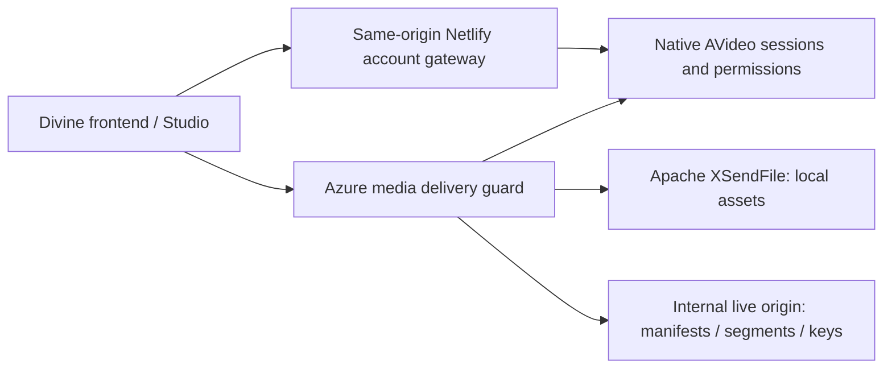

# First-party protected media delivery

Status: implementation design, not an active security control. Selected by the owner November 19, 2026. Production promotion remains blocked by SECURE-MEDIA-RELEASE-GATE.md.

## One authorization boundary

Netlify handles small account/API requests. Large media bodies stay on Azure, where Apache already supports XSendFile. Preserve native byte-range behavior for seeking. Do not relay large bodies through buffered Netlify functions or hold PHP session locks while streaming.

## Session exchange

The frontend has a host-only HttpOnly session cookie. It cannot be assumed to reach media.divinemedia.us. Add an authenticated, CSRF-protected gateway action issuing a short-lived, single-use random exchange grant. Keep only a digest server-side, bind it to the current native session and requesting frontend origin, and consume it atomically. Send it in a POST body to the media origin, never a URL. The origin issues its own host-only Secure HttpOnly session-bound delivery cookie. Never put native session IDs, passwords or the gateway secret in browser URLs or JavaScript storage.

Every protected request must resolve the live native session and current record permission. An exchange grant or signed URL alone is insufficient. Logout invalidates native access; removed permissions must affect subsequent requests. No independent login database. Rate-limit exchange and failed requests without logging secrets. Session lifetime, grant TTL and revocation behavior need explicit implementation tests.

Production is same-site but cross-origin. Deploy Previews are cross-site: browser third-party cookie restrictions must be exercised. Do not weaken cookies globally to make previews pass; report unsupported preview behavior and use a controlled same-site rehearsal host if required. Use explicit allowed origins and credentialed CORS where needed, never wildcard credentialed CORS.

## Asset resolution and authorization

Accept catalog IDs and registered asset/variant identifiers, never arbitrary filesystem paths or remote URLs. Resolve each derivative to its owning record using a server-controlled asset map; filename-prefix guessing is insufficient. Reuse native record visibility, account/group, password and entitlement decisions. Downloads additionally require native download permission. Public, unlisted and private remain separate policies.

Resolve canonical files inside allowlisted storage roots; deny traversal, symlink escapes, scripts, configuration, backups, credential directories and unregistered files. Deny ambiguous mappings. Verify authorization before emitting XSendFile. Set MIME from an allowlist, nosniff and safe disposition. Private responses use no-store and bypass shared caches, including denial responses; never redirect to raw files.

Artwork, portrait/landscape thumbnails, source images, PDFs, captions, alternate encodings and audio need the same ownership mapping. Public decorative/site branding assets remain a separate allowlist. Existing originals and thumbnail processing are preserved.

## HLS and live

Reauthorize every manifest, segment, key and nested playlist. Resolve relative references within a registered stream scope; external references require explicit trusted mapping. Rewrite manifests to guarded URLs without leaking ingest stream keys. Reuse native Live permission checks, including stream password policy. Protect the internal live origin and all published alternate ports so the rewritten manifest cannot be bypassed.

Short live segments already buffered before logout cannot be recalled. Test the next network request after revocation. Do not promise DRM or prevention of screen recording.

## Rollout and evidence

1. Add and test the origin/session components without routing existing traffic through them.
2. Rehearse against isolated, disposable public/private fixtures across media types, unrelated accounts and logged-out browsers.
3. Verify range requests, long playback, mobile Safari, HLS credential behavior, cookie restrictions, cache behavior and revocation. Include spoofed referrers, copied full URLs and direct alternate-origin requests.
4. Back up configuration, then enable guarded routes and raw-path denial together. Preserve a tested rollback; do not globally deny files before public playback and native operator/Encoder workflows pass. Never restart containers whose entrypoint reencodes existing content.
5. Run the release gate and publish only when all required cases pass.

External YouTube/Vimeo embeds remain controlled by their provider. Divine can gate the catalog page but cannot turn an externally public/unlisted source into Divine-only private media. Clearly distinguish that from securely hosted private content.

## Current implementation

The frontend now drops account state and selected/docked program media on successful logout or authenticated request expiry. Requests begun before revocation cannot restore old account responses or CSRF state. This is UI/session hygiene only; origin cookie exchange, asset mapping, XSendFile guard, live integration and bypass denial remain to be implemented and verified. The confirmed raw artwork leak is not fixed by this change.
