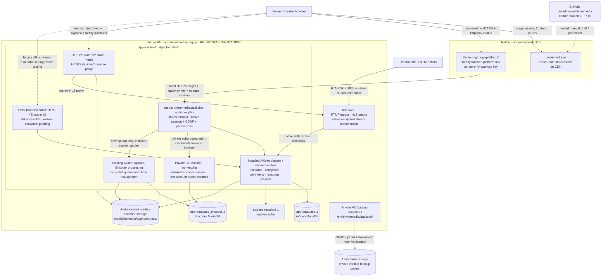

# Divine Media deployment architecture

This diagram describes the device-testing release approved November 9, 2026. Solid arrows are active connections; the legacy HTML branch remains accessible pending the separate public-route cutover. There is one new frontend, with AVideo retaining accounts and persistence.

## Request and session behavior

The browser receives an opaque __Host-dm_session cookie (Secure, HttpOnly, SameSite=Lax, host-only). A session-bound CSRF nonce authorizes writes. The Netlify function checks the frontend origin and forwards only supported actions to a fixed Azure endpoint. It passes a server-only gateway key and the opaque native session ID in headers. The adapter applies native AVideo login, permission, visibility and ownership checks and projects JSON; native HTML and credential-bearing login responses are not returned to the frontend.

Concurrent identical browser reads share a single request while it is in flight. Results are not retained as a client cache. Mutations invalidate pending-read sharing. User-specific API responses remain private/no-store. The HLS library loads only when needed; it is not part of the initial application bundle.

## Exact operational boundaries

- Netlify serves the frontend and its API gateway; Azure serves media bytes, native application logic, databases, upload/encoding and streaming.
- Encoder PHP runs inside app-avideo-1 under /Encoder/. app-database_encoder-1 is a database container, not a separate encoder compute worker. The new private CLI bridge uses the installed Encoder classes without exposing its HTML UI.
- The private CLI bridge creates and manages owned queue records. It deliberately does not launch the global queue or retry historical jobs. Conversion/output delivery still needs a dedicated new-file rehearsal.
- There is no new account, comment or playlist database, no replacement paid-plugin suite, and no Azure Media Services dependency.
- The new frontend has no native-page links or native HTML player iframes. Native public HTML remains reachable by direct legacy URLs in this release. The tested redirect helper exists, but its native head hook and enable flag are not deployed/activated. A private-only backend is the next cutover state, not the current state.
- Source is committed in GitHub and released through a verified Netlify draft. Promotion changes the published Netlify deploy; it does not merge the stacked PRs into production/divine-media.
- Private backup copies have been round-trip verified. This diagram does not assert a new scheduled backup policy or that snapshots continuously capture new user data.

## Remaining functionality before full public-route cutover

Authenticated review across devices, large-file upload validation, a new isolated Encoder conversion/output-delivery test, public playlist discovery, comment replies/editing and the remaining configured plugin surfaces. Existing uploads, videos, thumbnail processing and creator grants are preserved.
